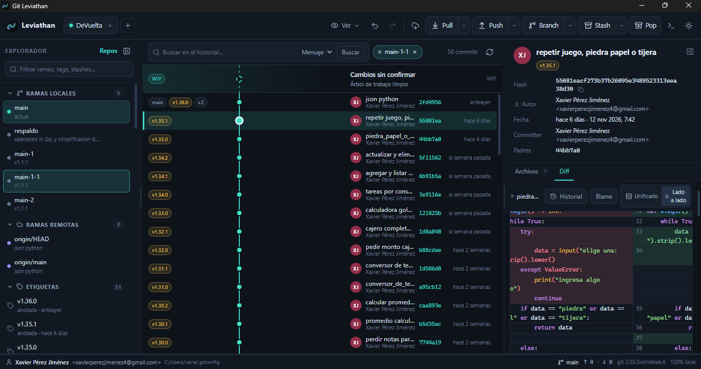

<p align="center">
  
</p>

<h1 align="center">Git Leviathan</h1>

<p align="center">
  Cliente de Git de escritorio, totalmente local y con aspecto de herramienta profesional.
  Sin cuentas, sin nube y sin telemetría.
</p>

Git Leviathan usa **exclusivamente el binario `git` de tu sistema**: respeta tu configuración,
tus hooks, tus credenciales y tus flujos de trabajo. Nunca escribe configuración de Git por ti.

<p align="center">
  
</p>

- Grafo de commits visual y fluido, incluso con repositorios grandes.
- Staging por archivo, hunk y línea, con diff unificado o dividido y resaltado de sintaxis.
- Ramas, remotos, tags, stashes y worktrees con filtro.
- Merge, rebase, cherry-pick, revert, reset, conflictos, blame, historial por archivo y búsqueda.
- Terminal integrada con pestañas.
- Operaciones largas con progreso en vivo y cancelación.
- Undo/redo seguro y confirmaciones explícitas antes de cualquier acción destructiva.
- Tema oscuro y claro.

## Requisitos

- **Git 2.30 o superior** instalado y disponible en el `PATH`. Git Leviathan no incluye ni instala Git.
- **Node.js 20+** y **npm**.
- **Rust estable** con `cargo` (instalado con [rustup](https://rustup.rs)).
- Dependencias del sistema para Tauri 2:
  - **Windows:** Microsoft C++ Build Tools y WebView2 (incluido en Windows 10/11 actualizados).
  - **macOS:** Xcode Command Line Tools.
  - **Linux:** `libwebkit2gtk-4.1-dev`, `libappindicator3-dev`, `librsvg2-dev`, `patchelf` y `build-essential`.

No necesitas cuenta, servidor ni conexión a Internet para usar la aplicación.

## Desarrollo

```bash
npm install
npm run tauri dev
```

Comprobaciones y pruebas:

```bash
npm run build   # TypeScript + Vite
npm test        # pruebas de integración del backend Rust
```

## Instalador

Genera la aplicación y los instaladores nativos de tu sistema:

```bash
npm run tauri build
```

Los artefactos se crean dentro de `src-tauri/target/release/bundle/`.

## Rutas del instalador e instalación

Los nombres incluyen el nombre del producto y la versión (`0.1.1` en esta entrega).

### Windows

- MSI: `src-tauri\target\release\bundle\msi\Git Leviathan_0.1.1_x64_en-US.msi`
- NSIS: `src-tauri\target\release\bundle\nsis\Git Leviathan_0.1.1_x64-setup.exe`

Instala abriendo cualquiera de los dos archivos con doble clic y siguiendo el asistente.

### macOS

- DMG (Apple Silicon): `src-tauri/target/release/bundle/dmg/Git Leviathan_0.1.1_aarch64.dmg`
- DMG (Intel): `src-tauri/target/release/bundle/dmg/Git Leviathan_0.1.1_x64.dmg`
- Aplicación: `src-tauri/target/release/bundle/macos/Git Leviathan.app`

Abre el `.dmg` y arrastra **Git Leviathan** a la carpeta **Aplicaciones**. Si macOS lo bloquea
la primera vez, usa **Abrir** desde el menú contextual o Ajustes → Privacidad y seguridad.

### Linux

- DEB: `src-tauri/target/release/bundle/deb/git-leviathan_0.1.1_amd64.deb`
- RPM: `src-tauri/target/release/bundle/rpm/git-leviathan-0.1.1-1.x86_64.rpm`
- AppImage: `src-tauri/target/release/bundle/appimage/git-leviathan_0.1.1_amd64.AppImage`

```bash
sudo apt install ./src-tauri/target/release/bundle/deb/git-leviathan_0.1.1_amd64.deb
sudo dnf install ./src-tauri/target/release/bundle/rpm/git-leviathan-0.1.1-1.x86_64.rpm
chmod +x ./src-tauri/target/release/bundle/appimage/git-leviathan_0.1.1_amd64.AppImage
./src-tauri/target/release/bundle/appimage/git-leviathan_0.1.1_amd64.AppImage
```

## Uso rápido

1. Abre **Git Leviathan** y elige **Abrir repositorio**, **Inicializar** o **Clonar**.
2. Selecciona archivos o hunks en el panel izquierdo y prepara el commit desde el panel derecho.
3. Haz doble clic en una rama para cambiarte; usa el menú contextual para crear, renombrar o borrar.
4. Explora el grafo; al seleccionar un commit verás sus detalles y sus diffs.
5. Usa la terminal integrada para cualquier comando que la interfaz no cubra.
6. La barra inferior muestra la identidad efectiva de Git y su origen (`git config --show-origin`).
   Si falta `user.name` o `user.email`, la app te avisa antes de confirmar.

Todo se ejecuta contra tu repositorio local y tu Git de confianza.
